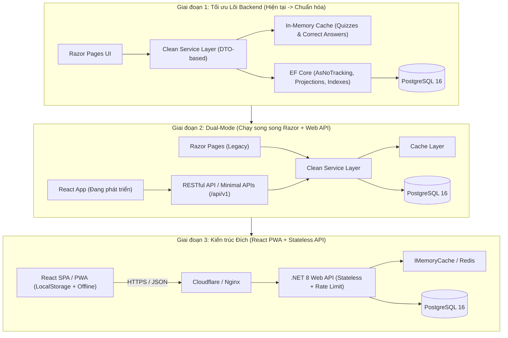

# Kế hoạch Cải thiện Backend & Lộ trình Chuyển đổi sang React (Architecture & Migration Plan)

Tài liệu này phác thảo chiến lược nâng cấp hệ thống **QuizCarLicense** theo mô hình **Strangler Fig Pattern** (nâng cấp dần mà không làm gián đoạn hệ thống đang chạy):
1. **Giai đoạn 1:** Cải thiện và tối ưu hóa lõi Backend (.NET 8 + PostgreSQL + EF Core), khắc phục toàn bộ điểm nghẽn hiệu năng và bảo mật trong khi vẫn giữ giao diện Razor Pages hoạt động ổn định.
2. **Giai đoạn 2:** Xây dựng tầng RESTful API (`/api/v1/...`) dùng chung tầng Service đã tối ưu, chuẩn bị sẵn sàng cho Frontend mới.
3. **Giai đoạn 3:** Phát triển Frontend **React (Vite + TypeScript + PWA)** và chuyển đổi hoàn toàn từ Server-Side Rendering (Razor Pages) sang Client-Side Rendering.

---

## 1. Kiến trúc Tổng thể & Lộ trình Chuyển đổi



---

## 2. Giai đoạn 1: Cải thiện & Tối ưu hóa Backend hiện tại

Mục tiêu của giai đoạn này là giải quyết triệt để các điểm nghẽn trong code hiện tại để hệ thống chịu tải cao, bảo mật và **tách biệt hoàn toàn logic nghiệp vụ khỏi Razor Pages**.

### 2.1. Tách biệt Tầng Nghiệp vụ (Clean Service Layer)
Hiện tại, một số PageModel vẫn chọc thẳng vào Database hoặc phụ thuộc vào cơ chế của Razor Pages. Cần chuẩn hóa lại:
- **Loại bỏ truy cập `DbContext` trực tiếp ở PageModel:**
  - *Vấn đề:* `Pages/Take/Index.cshtml.cs` đang inject trực tiếp `QuizCarLicenseContext` để truy vấn lịch sử thi.
  - *Giải pháp:* Chuyển toàn bộ truy vấn về `ITakeService`. PageModel (và Controller sau này) chỉ gọi qua Interface của Service.
- **Chuẩn hóa Input/Output của Service bằng DTO (Không trả về EF Entity thô):**
  - *Vấn đề:* `IQuizService` và `ITakeService` đang trả về trực tiếp model EF (`Quiz`, `Take`) có chứa vòng lặp tham chiếu (`Quiz -> Questions -> Quizzes`), gây lỗi `JsonException` khi trả về qua API cho React sau này.
  - *Giải pháp:* Tạo các Record/DTO rõ ràng (`QuizSummaryDto`, `QuizDetailDto`, `TakeHistoryDto`, `TakeResultDto`).
- **Tách `AuthService` khỏi Cookie Authentication:**
  - *Vấn đề:* `AuthService.Login()` trong `Repositories/Implementations/AuthService.cs` đang trực tiếp khởi tạo `ClaimsPrincipal` với `CookieAuthenticationDefaults.AuthenticationScheme`.
  - *Giải pháp:* `AuthService` chỉ xác thực và trả về `AuthenticatedUserDto` (gồm `UserId`, `Username`, `FullName`, `Role`). Việc đóng gói thành Cookie (cho Razor Pages) hay JWT Token (cho React) sẽ do tầng Web/API đảm nhận.

### 2.2. Bổ sung Tầng Caching (`IMemoryCache`) cho Đề thi & Chấm điểm
Đặc thù bộ 600 câu hỏi sát hạch rất ít khi thay đổi nhưng được đọc liên tục:
- **Cache cấu trúc Đề thi & Câu hỏi (`GetQuizWithQuestionsAsync`):**
  - Lưu danh sách câu hỏi và lựa chọn đáp án (không kèm cờ `IsCorrect`) vào `IMemoryCache` theo key `quiz:questions:{quizId}` với TTL 6–24 giờ.
- **Chấm điểm trong RAM (`CalculateScoreAsync` — Zero DB Query):**
  - *Vấn đề:* Hiện tại mỗi lần nộp bài, `TestService.CalculateScoreAsync` thực hiện 2 truy vấn xuống bảng `QuizAnswers` để lấy đáp án người dùng chọn và đáp án đúng.
  - *Giải pháp:* Cache cấu trúc `Dictionary<int, HashSet<int>>` (Map từ `QuestionId -> Set<CorrectAnswerId>`) theo key `quiz:answer-key:{quizId}`. Khi người dùng nộp bài, Backend chấm điểm trực tiếp trên RAM trong `< 1ms` mà không cần đọc Database, chỉ thực hiện 1 lệnh `INSERT` duy nhất để lưu kết quả (`Take` & `TakeAnswer`).
- **Cơ chế Cache Invalidation:**
  - Khi Admin thêm/sửa/xóa câu hỏi hoặc cập nhật đề thi trong `QuizService` và `QuestionService`, tự động xóa cache key tương ứng.

### 2.3. Tối ưu hóa Truy vấn EF Core & Database Indexing
Khắc phục các truy vấn gây chậm (N+1 / Cartesian Explosion) trong code hiện tại:
- **Loại bỏ việc load toàn bộ `Questions` chỉ để đếm số lượng:**
  - *Vấn đề:* Trong `TakeService.GetRecentTakesAsync` và `Pages/Take/Index.cshtml.cs`, code đang dùng `.Include(t => t.Quiz).ThenInclude(q => q.Questions)` chỉ để lấy `Questions.Count` hiển thị ra giao diện.
  - *Giải pháp:* Dùng `.Select()` projection để SQL tính `COUNT(*)` trực tiếp:
    ```csharp
    .Select(t => new TakeHistoryDto {
        TakeId = t.TakeId,
        QuizTitle = t.Quiz.Title,
        Score = t.Score,
        TotalQuestions = t.Quiz.Questions.Count(),
        StartedAt = t.StartedAt,
        FinishedAt = t.FinishedAt
    })
    ```
- **Tối ưu `TakeService.GetTakeWithAnswersAsync`:**
  - *Vấn đề:* Đang dùng chuỗi `.Include().ThenInclude()` nhiều tầng liên tiếp và sau đó gọi thêm `LoadUnTakenQuestionsAsync` gây query trùng lặp.
  - *Giải pháp:* Kết hợp dữ liệu câu hỏi của đề thi từ Cache với danh sách `TakeAnswers` của lượt thi (chỉ cần 1 query nhẹ lấy `TakeId`, `Score`, `StartedAt` và danh sách `AnswerId` đã chọn).
- **Tạo Migration bổ sung Index cho PostgreSQL:**
  - Index tìm kiếm lịch sử làm bài: `IX_Take_UserId_StartedAt` trên bảng `Take (UserId, StartedAt DESC)`.
  - Index lọc đáp án đúng: `IX_QuizAnswer_QuestionId_IsCorrect` trên bảng `QuizAnswer (QuestionId, IsCorrect)`.
  - Unique Index cho tài khoản: `UX_Users_Username` trên bảng `Users (Username)`.

### 2.4. Nâng cấp Bảo mật & Chuyển sang Kiến trúc Stateless
- **Nâng cấp thuật toán băm mật khẩu (Password Hashing):**
  - *Vấn đề:* `StringUtils.ComputeSha256Hash` không có Salt, dễ bị tấn công dò mật khẩu.
  - *Giải pháp:* Sử dụng `PasswordHasher<User>` (chuẩn PBKDF2 của ASP.NET Core Identity) hoặc `BCrypt.Net-Next`.
  - *Chiến lược chuyển đổi mượt (Zero-downtime):* Khi user đăng nhập, kiểm tra nếu hash trong DB có độ dài 64 ký tự hex (SHA-256 cũ) thì xác thực bằng SHA-256, sau đó tự động băm lại bằng chuẩn mới và cập nhật vào DB.
- **Loại bỏ Server Session cho Guest (`GuestTestResult`):**
  - *Vấn đề:* `HttpContext.Session.SetString("GuestTestResult", ...)` lưu kết quả thi của khách vào bộ nhớ RAM của server, gây tốn RAM khi nhiều khách cùng thi và không thể chạy nhiều container song song.
  - *Giải pháp:* Khi khách (chưa đăng nhập) bấm nộp bài, API chấm điểm xong và trả trực tiếp chi tiết kết quả (điểm số + đáp án đúng/sai) về JSON response để Client lưu vào `sessionStorage`/`localStorage`. Backend hoàn toàn **Stateless**.

---

## 3. Giai đoạn 2: Xây dựng tầng RESTful API (Chuẩn bị cho React)

Sau khi tầng Service đã sạch và tối ưu ở Giai đoạn 1, chúng ta mở thêm các API Endpoint chạy song song với Razor Pages.

### 3.1. Thiết kế Cấu trúc API Endpoints (`/api/v1`)

| Phân hệ | Method & Endpoint | Mô tả | Ghi chú kỹ thuật |
| :--- | :--- | :--- | :--- |
| **Auth** | `POST /api/v1/auth/login` | Đăng nhập, trả về JWT / HttpOnly Cookie | Rate limit: 5 req/phút/IP |
| | `POST /api/v1/auth/register` | Đăng ký tài khoản mới | Validate dữ liệu đầu vào |
| | `POST /api/v1/auth/logout` | Đăng xuất | Xóa token/cookie |
| | `GET /api/v1/auth/me` | Lấy thông tin user hiện tại | Dùng khi React khởi động |
| **Quizzes** | `GET /api/v1/quizzes` | Danh sách bộ đề thi công khai | Có `OutputCache` (5 phút) |
| | `GET /api/v1/quizzes/{id}` | Chi tiết đề thi + danh sách câu hỏi làm bài | Lấy từ `IMemoryCache` |
| **Testing** | `POST /api/v1/quizzes/{id}/submit` | Nộp bài thi & nhận kết quả chấm điểm | Chấm trên RAM; Lưu DB nếu đã login, trả kết quả ngay nếu là Guest |
| **History** | `GET /api/v1/takes` | Lịch sử các lần thi của User (có phân trang) | Yêu cầu xác thực |
| | `GET /api/v1/takes/{takeId}` | Xem lại chi tiết đúng/sai của 1 lần thi | Kiểm tra quyền sở hữu `UserId` |
| **Admin** | `POST /api/v1/admin/quizzes` | Tạo/Cập nhật đề thi & gán câu hỏi | Xóa cache đề thi sau khi lưu |
| | `POST /api/v1/admin/questions` | Quản lý ngân hàng 600 câu hỏi & ảnh | Role: `AdminOnly` |

### 3.2. Các Thành phần Hạ tầng API cần thêm trong .NET 8
1. **CORS Policy:** Cấu hình cho phép domain của React (ví dụ `http://localhost:5173` khi dev và domain chính khi production).
2. **Rate Limiting (`Microsoft.AspNetCore.RateLimiting`):**
   - Giới hạn tần suất gọi API `/submit` và `/login` để chống bot spam làm nghẽn DB.
3. **Response Compression & Output Caching:**
   - Bật nén `Brotli` / `Gzip` cho JSON payload (giảm ~70% dung lượng tải bộ câu hỏi về máy điện thoại).
4. **Global Exception Handling & ProblemDetails:**
   - Chuẩn hóa mọi lỗi trả về dạng JSON theo chuẩn RFC 7807 (`{ title, status, detail, errors }`) để React dễ dàng bắt lỗi và hiển thị Toast.
5. **Swagger / OpenAPI:**
   - Tự động sinh tài liệu API để đối chiếu và generate TypeScript types cho phía React.

---

## 4. Giai đoạn 3: Chuyển đổi Frontend sang React (SPA / PWA)

Khi toàn bộ API ở Giai đoạn 2 đã sẵn sàng và được kiểm thử qua Swagger, tiến hành xây dựng giao diện React mới.

### 4.1. Tech Stack khuyến nghị cho Frontend
- **Build Tool & Framework:** React 18+ + TypeScript + Vite (tốc độ build cực nhanh, gọn nhẹ hơn Next.js vì phần thi trắc nghiệm cần tương tác Client-side mạnh).
- **Styling & UI:** TailwindCSS + Shadcn/UI (đồng bộ với phong cách Tailwind hiện có của dự án).
- **Quản lý Server State (Data Fetching):** **TanStack Query (React Query)** — tự động cache danh sách đề thi, retry khi mạng chập chờn.
- **Quản lý Client State (Trạng thái đang làm bài):** **Zustand** kết hợp middleware `persist` (lưu tự động vào `localStorage` hoặc `IndexedDB`).

### 4.2. Cải tiến Trải nghiệm Làm bài thi (Quiz Engine trên React)
1. **Không bao giờ mất bài làm khi F5 hoặc đứt mạng:**
   - Ngay khi học viên chọn đáp án A/B/C/D, `Zustand` lưu ngay trạng thái `{ quizId, startTime, duration, selectedAnswers }` vào `localStorage`.
   - Nếu học viên lỡ đóng tab hoặc rớt mạng 4G, khi mở lại trang sẽ tự động khôi phục đúng câu đang làm và thời gian còn lại.
2. **Hỗ trợ chế độ Luyện tập vs Thi sát hạch:**
   - *Chế độ Luyện tập (Practice Mode):* Chọn đáp án xong báo đúng/sai và giải thích ngay tại chỗ.
   - *Chế độ Thi thử (Exam Mode):* Đếm ngược thời gian, bấm nộp bài mới chấm điểm và cảnh báo nếu sai "Câu điểm liệt".
3. **Progressive Web App (PWA):**
   - Tích hợp `vite-plugin-pwa` để cache tĩnh toàn bộ giao diện và hình ảnh biển báo/sa hình. Học viên có thể "Thêm vào màn hình chính" trên iOS/Android như một ứng dụng thực thụ.

### 4.3. Mô hình Triển khai (Deployment) sau khi lên React
- **Frontend (React):** Build ra thư mục tĩnh (`dist/`), có thể:
  - *Cách 1 (Đơn giản, tiết kiệm):* Copy vào `wwwroot` của .NET 8 hoặc chạy qua 1 container **Nginx** siêu nhẹ (~20MB RAM) đứng trước làm Reverse Proxy cho cả Frontend và `/api`.
  - *Cách 2 (Tối ưu tốc độ toàn cầu):* Deploy miễn phí lên **Cloudflare Pages / Vercel**, gọi API về VPS chạy Docker `.NET 8 + PostgreSQL`.

---

## 5. Checklist Thứ tự Thực hiện (Action Plan)

### Bước 1: Dọn dẹp & Tối ưu Backend (Ưu tiên làm ngay)
- [x] **Task 1.1:** Tạo các DTO chuẩn cho Quiz, Question, Take và tách `QuizCarLicenseContext` ra khỏi các PageModel (`Pages/Take/Index.cshtml.cs`).
- [x] **Task 1.2:** Tích hợp `IMemoryCache` vào `TestService` và `QuizService` (cache câu hỏi và chấm điểm hoàn toàn trên RAM).
- [x] **Task 1.3:** Tối ưu các hàm EF Core trong `TakeService` (bỏ `.Include` thừa, dùng Projection `Select`, thêm `.AsNoTracking()`, `.AsSplitQuery()`).
- [x] **Task 1.4:** Tạo EF Migration thêm Index cho bảng `Take`, `QuizAnswer`, `Users` (`20261025042552_AddPerformanceIndexes`).
- [x] **Task 1.5:** Nâng cấp `AuthService` sang dùng `PasswordHasher` (hỗ trợ tự động migrate từ SHA-256 cũ) và tách logic Cookie ra khỏi Service.
- [x] **Task 1.6:** Cập nhật lại `README.md` cho khớp với PostgreSQL 16 thực tế đang dùng.

### Bước 2: Mở rộng Web API cho React
- [x] **Task 2.1:** Cấu hình `AddControllers()`, JWT Bearer Authentication, Swagger với Bearer UI, CORS, Response Compression, Output Caching và Rate Limiting trong `Program.cs` / `ServiceCollectionExtensions.cs`.
- [x] **Task 2.2:** Xây dựng các API Controller (`/api/v1/auth`, `/api/v1/quizzes`, `/api/v1/takes`, `/api/v1/admin/quizzes`, `/api/v1/admin/questions`).
- [x] **Task 2.3:** Chuyển luồng Guest Submit sang Stateless (trả kết quả trực tiếp qua JSON kèm chi tiết câu đúng/sai hoàn toàn trên RAM - Zero DB Read - thay vì lưu `HttpContext.Session`).

### Bước 3: Xây dựng Frontend Hiện Đại (Next.js App Router + Song Ngữ + SEO) & Chuyển giao
- [x] **Task 3.1:** Tái cấu trúc Monorepo (`backend/` + `frontend/`) & Khởi tạo Next.js App Router (TypeScript, Tailwind CSS, Lucide icons, next-intl song ngữ vi/en, Impeccable Design System).
- [x] **Task 3.2:** Xây dựng màn hình Phòng thi sát hạch (Exam Engine) với Zustand persist (`localStorage`), phím tắt bàn phím (1-4, Mũi tên, F), đồng hồ đếm ngược `tabular-nums` và tự nộp bài khi hết giờ.
- [x] **Task 3.3:** Xây dựng màn hình Danh sách đề thi SSR, Tra cứu ngân hàng 600 câu kèm Schema.org JSON-LD `QAPage` tối ưu SEO, Xem kết quả (Guest Stateless & Lưu DB), Lịch sử thi và Trang Quản trị (Admin Quizzes & Questions).
- [ ] **Task 3.4:** Gỡ bỏ thư mục `backend/Pages/` (Razor Pages) sau giai đoạn nghiệm thu toàn diện (Hiện tại đang giữ Dual-mode chạy song song an toàn).
